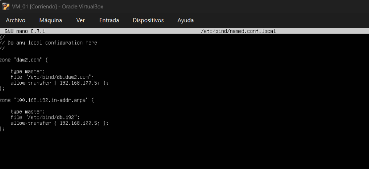
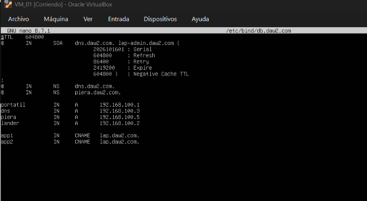
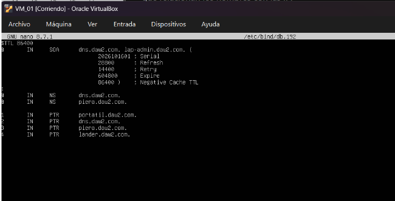
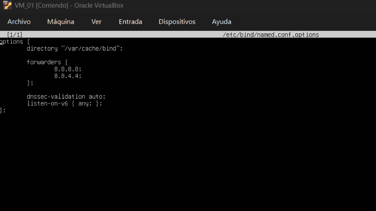

# dns_grupal : parte DNS master

## 1. Configuración de direcciones ip

Después de las configuraciones habituales de netplan, hacer la respectiva instalación de bind9, yo como dns master debo configurar 4 ficheros.

---

## 2. El primero “named.conf.local”

DeclarO las zonas DNS y le indica a BIND9 que dominios y zonas debe gestionar.
Luego declaro la zona directa del dominio.
Indico que soy el maestro en el servidor “type master;” 
También el archivo que contiene cualquier registro con el file “ dirección “.
Con “allow-transfer” le doy permiso al DNS esclavo copie o pida una transferencia de la zona.
Y a su vez declaró la zona inversa con los aspectos similares.

---

## 3. Creación y configuración del archivo db.daw2.com

Este archivo va contener los registros que permiten convertir un dominio en una IP.

dns.daw2.com.  Es el servidor principal asociado a la zona y lap-admin.daw2.com. Es el contacto administrativo de la zona.

---

## 4. Turno del db.192

Este fichero trabaja la zona inversa

Acá el fichero asocia la IP con el dominio.

---

## 5. Por último el archivo named.conf.option:

Debo establecer la configuración general del servidor.

---
