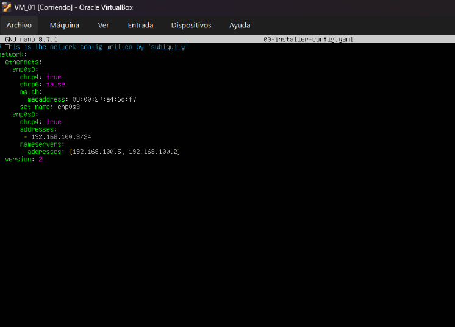

# dns_grupal : parte DNS master

## 1. Configuración de fichero "named.conf.local"

Después de las configuraciones habituales de netplan, hacer la respectiva instalación de bind9, yo como dns master debo configurar 4 ficheros.


```bash
El primero “named.conf.local”, donde declaró las zonas DNS y le indica a BIND9 que dominios y zonas debe gestionar.

```


---

## 2. Instalación del ssh

Se instaló el servidor SSH para permitir la administración remota de la máquina:

```bash
sudo apt install -y openssh-server
```


---

## 3. Instalación de las dependencias de Webmin

Se instalaron las herramientas necesarias para configurar el repositorio de Webmin:

```bash
sudo apt install -y software-properties-common apt-transport-https
```


---

## 4. Descarga del script

```bash
curl -o webmin-setup-repo.sh https://raw.githubusercontent.com/webmin/webmin/master/webmin-setup-repo.sh
```


---

## 5. Configuración del repositorio de Webmin

Este script configura el repositorio necesario para poder instalar Webmin mediante APT.

```bash
sudo sh webmin-setup-repo.sh
```


---
